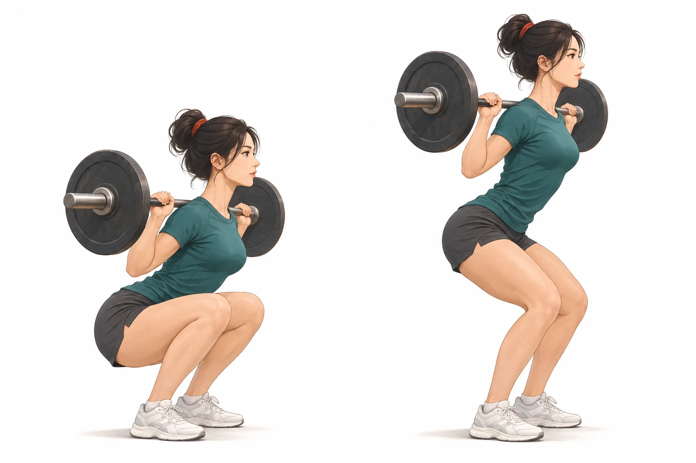
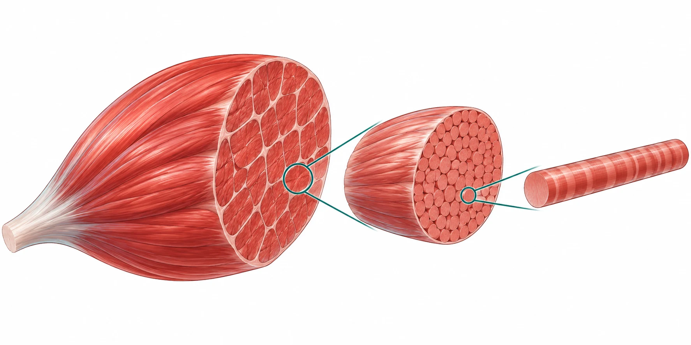
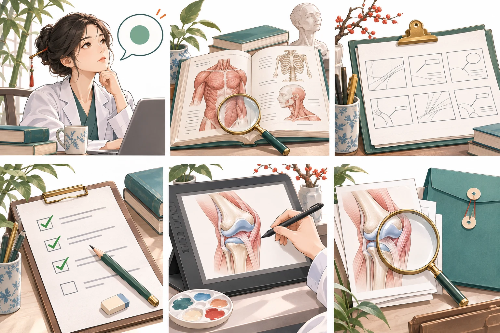

<p align="center"></p>

# 运动解剖与医学绘图 Skill · Sports Anatomy Illustration

[查看自动校验结果](https://github.com/wbin888/sports-anatomy-illustration/actions/workflows/validate.yml)

这是一个面向 AI Agent（Claude Code、Codex、Copilot 等支持 [Agent Skills](https://agentskills.io/specification) 的宿主）的 Skill，用于制作**有据可查**的人体解剖与运动解剖插画：

- 🏋️ **运动解剖图**：训练动作的肌肉分工、主动肌/协同肌/拮抗肌/稳定肌，以及向心、离心、等长收缩的视觉编码
- 🏃 **动作分期图**：深蹲、硬拉、俯卧撑、跑步步态、纵跳等的分期、关节动作和力/力矩箭头
- 🩹 **运动损伤与康复示意**：ACL、踝扭伤、腘绳肌拉伤、肩袖等损伤的取证要点，以及康复示范的表达边界
- 💬 **面向患者和公众的科普漫画**：多格叙事、生活化语言、就医提示
- 📚 **教学与宣教用的医学插画**：一图一目标、层次放大、标准术语
- 🔬 **涉及医学结构的科研示意图**：机制关系登记、证据状态线型、期刊排版
- 🔎 **每幅解剖图都能追溯到具体参考**：图中标来源 ID，并附逐图对照表

本项目改编自 [wilbert-MD-PhD/medical-illustration](https://github.com/wilbert-MD-PhD/medical-illustration)（MIT），并新增运动解剖模块。

## 新增的运动解剖模块

<p align="center"></p>

<p align="center"><sub>杠铃后蹲：左为接近下蹲底部，右为起身途中。仅示意动作阶段，不作技术处方或肌肉激活测量。依据：SQ22。</sub></p>

| 内容 | 位置 |
|---|---|
| 运动解剖绘图规则：动作坐标、肌肉角色与收缩、结构表达、箭头、证据选择、常见错误 | [`references/sports-anatomy.md`](skills/sports-anatomy-illustration/references/sports-anatomy.md) |
| 动作分析流程与 `movement-spec.json` 字段 | [`references/movement-analysis.md`](skills/sports-anatomy-illustration/references/movement-analysis.md) |
| 运动损伤机制与康复图示规则 | [`references/sports-injury-and-rehab.md`](skills/sports-anatomy-illustration/references/sports-injury-and-rehab.md) |
| 33 块主要运动肌：起止点、动作、神经支配、节段 | [`data/muscles.json`](skills/sports-anatomy-illustration/data/muscles.json) |
| 关节动作受控词表：平面、相反动作、中文术语 | [`data/joint-actions.json`](skills/sports-anatomy-illustration/data/joint-actions.json) |
| 5 个定性动作模板 | [`data/movements.json`](skills/sports-anatomy-illustration/data/movements.json) |
| 动作规格校验器 | [`scripts/check_movement_spec.py`](skills/sports-anatomy-illustration/scripts/check_movement_spec.py) |

校验器会检查以下问题：

- 未知的肌肉或关节动作
- 角度、EMG 等数值，以及力/力矩箭头缺少来源
- 肌肉所控制的动作不属于当前分期
- 向心或离心收缩的方向与肌肉动作矛盾，例如下蹲时把臀大肌标为“向心”
- 关节动作不在当前观察平面内，例如在侧视图中标注髋内收

> 数据文件只是教学索引，不能作为视觉证据。起止点、神经根节段等在不同教材间存在差异，作图前须按所选来源逐项核对。

## 三类作品

用 `init_project.py --type comic|teaching|research` 建立对应项目，各类型的读者、叙事和交付要求见 [`references/output-types.md`](skills/sports-anatomy-illustration/references/output-types.md)。

| 类型 | 面向 | 示例 |
|---|---|---|
| 科普漫画 `comic` | 患者与公众 | 跑完步，膝盖前面为什么疼？ |
| 教学与宣教插画 `teaching` | 学生、患者宣教 | 骨骼肌的结构层次 |
| 科研示意图 `research` | 论文、基金、学术报告 | 抗阻训练与骨骼肌肥大 |

<p align="center"></p>
<p align="center"><sub>科普漫画分镜：跑后发现不适 → 咨询专业人员 → 记下交流要点。虚构情境，不以疼痛位置推断诊断。</sub></p>

<p align="center"></p>
<p align="center"><sub>教学插画：骨骼肌 → 肌束 → 肌纤维。各层逐级放大，不按共同尺度绘制。依据：SEER。</sub></p>

<p align="center"></p>
<p align="center"><sub>科研绘图主题插画。实际关系和证据状态见下方的科研关系登记，屏幕图案不代表实验数据或机制结论。</sub></p>

## 每幅解剖图都能追溯到具体参考

含解剖结构或动作阶段的示例在图注中标明来源 ID，逐图、逐元素的对照见 [`docs/examples/references.md`](docs/examples/references.md)。科研机制的证据状态和来源另见 [`research-example.mechanism-graph.json`](docs/examples/research-example.mechanism-graph.json)。

- 教学插画按 NCI SEER 原图核对骨骼肌层次；动作示意只呈现外观阶段，不从图片推断肌电和负荷。
- 示例图用于说明呈现方式；含医学内容的图尚未由专业人员审签。

## 制作流程

<p align="center"></p>

按从左到右、从上到下阅读：明确问题 → 核对参考 → 拟定规格 → 检查自洽 → 制图排字 → 质检交付。道具上的图画仅为流程场景，不作结构讲解。

## 安装

**Claude Code（插件市场）**

```text
/plugin marketplace add wbin888/sports-anatomy-illustration
/plugin install sports-anatomy-illustration@sports-anatomy-illustration
```

**手动安装（任意支持 Skill 的宿主）**：把整个 `skills/sports-anatomy-illustration/` 目录复制到宿主的技能目录，例如 `~/.claude/skills/`、项目的 `.claude/skills/` 或 `~/.codex/skills/`，然后刷新宿主。

不支持 Skill 的 Agent，可以在对话中直接指定 `SKILL.md` 的路径，详见 [Agent 接入](skills/sports-anatomy-illustration/references/agent-integration.md)。

## 快速开始

```bash
cd skills/sports-anatomy-illustration
python3 scripts/init_project.py ~/my-squat-figure --sports      # 建立项目，含动作分期表与 movement-spec.json
python3 scripts/init_project.py ~/knee-comic --type comic        # 科普漫画；另有 teaching、research
python3 scripts/check_movement_spec.py ~/my-squat-figure/02_动作分析/movement-spec.json
python3 scripts/check_movement_spec.py                          # 自检随包的 5 个动作模板
```

示例请求：

```text
使用 sports-anatomy-illustration，为健身新手画一张杠铃深蹲的两分期肌肉分工图（右侧矢状面），
标出主动肌、稳定肌和收缩方式，附来源记录，并输出可编辑 PPTX 与 PDF。
```

## 测试

仅需 Python 3.9+ 标准库；Illustrator 运行时测试中的裁切用例另需 Pillow。

```bash
python3 tests/test_movement_spec.py
python3 tests/test_init_project.py
python3 tests/test_mechanism_graph.py
python3 tests/test_illustrator_runtime.py
```

## 许可与免责声明

- 整包采用 [MIT](LICENSE)：Copyright © 2026 wilbert（上游核心 Skill），Copyright © 2026 wbin888（改编与运动解剖模块）。改编内容见 [NOTICE.md](skills/sports-anatomy-illustration/NOTICE.md)。
- README 的六张 WebP 由图像生成工具重新生成，没有使用旧 SVG 或复制上游展示图。[生成提示词](docs/images/prompts.md)。
- 本 Skill 只提供制作与质控流程，**不构成医疗、训练或康复建议**，不代表任何作品已通过医学审核。缺少人工审签的作品，应标为“制作完成，医学待审”。
